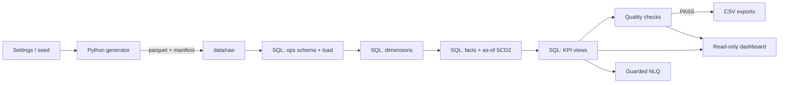

# Architecture

## 1. Overview

WealthOps is a local, deterministic analytics stack. A seeded Python generator writes parquet
files; SQL builds the operational warehouse, dimensions, facts and KPI views in DuckDB; a
quality gate validates the result; CSV marts and a read-only Streamlit application consume the
governed views.



The database is a single local file (`data/wealthops.duckdb`), rebuilt from scratch by
`make demo`/`make build`. There is no server, scheduler or cloud dependency.

## 2. Components

| Layer | Location | Responsibility |
|---|---|---|
| Scenario settings | `src/wealthops/config.py` | Seed, sizes, observation window, paths, environment overrides. |
| Generator | `src/wealthops/generate.py` | Builds channels, advisors, clients, accounts, SCD2 assignments, engagement, flows and monthly snapshots with independent RNG streams. |
| Orchestration | `src/wealthops/pipeline.py` | generate → load → transform → quality → export; writes the scenario config and manifest. |
| SQL warehouse | `sql/` | Operational schema, load, dimensions, facts, KPI views and checks. |
| CLI | `src/wealthops/cli.py` | `generate`, `load`, `transform`, `quality`, `export`, `build`, `status`, `reset`, `nlq`. |
| Dashboard data access | `src/wealthops/dashboard/data.py` | Short-lived read-only queries against governed views. |
| Dashboard UI | `dashboard/app.py` | Six Streamlit workspaces, filters, charts and definitions. |
| NLQ | `src/wealthops/nlq/` | Guard, deterministic rules, optional LLM adapter, execution engine. |
| Tests | `tests/` | Pipeline reconciliation, KPI mathematics, SCD2, generator determinism, guard, dashboard. |

## 3. Data flow

1. `generate` creates all logical tables in memory from `Settings`. Each table/step uses an
   independent NumPy RNG stream derived from the seed, so changing one table does not silently
   perturb another. Tables are written to parquet; the manifest records seed, sizes, window,
   row counts and a SHA-256 logical fingerprint per table.
2. `load` creates the `ops` schema, truncates/loads parquet through DuckDB, and writes declared
   scenario counts into `ops.scenario_config`.
3. `transform` runs every non-load SQL file in lexical order: dimensions (`10_`), facts (`20_`),
   then KPI views (`30_`–`38_`). Views are created with `CREATE OR REPLACE`.
4. `quality` executes `sql/quality/checks.sql` and materialises the latest results in
   `analytics.v_data_quality`.
5. `export` reads the governed views and writes 12 CSVs to `exports/`.
6. The dashboard and NLQ read the same views. Neither writes to the database.

## 4. Schemas and modelling

### Operational layer (`ops`)

Normalised, business-keyed tables:

- `channel`, `advisor`, `client`, `account`
- `advisor_assignment` (SCD2)
- `transaction`
- `monthly_asset_snapshot`
- `engagement_event`
- `scenario_config` (quality-check parameters)

Primary keys are business identifiers (`CL…`, `AC…`, `TX…`, `MS…`, `EV…`, `AA…`). Foreign keys
express the main relationships. The operational layer is not queried directly by the dashboard.

### Analytics layer (`analytics`)

Conformed dimensions:

- `dim_date` — one row per day, with month start/end and year-month attributes.
- `dim_client` — surrogate `client_key`, channel attributes, cohort month, active flag, tenure.
- `dim_advisor` — surrogate keys plus an `advisor_key = 0` “Unassigned” member.
- `dim_channel` — channel key and descriptive attributes.
- `dim_account` — account attributes and fee flags.
- `dim_advisor_assignment` — assignment intervals with client/advisor keys.

Facts:

- `fact_flows` — transaction grain, signed INR amount, net-new flag, as-of advisor.
- `fact_monthly_assets` — account-month grain, full asset recurrence, fee-based flag and as-of
  advisor.
- `fact_engagement` — event grain, event type, duration, as-of advisor.

The star schema is deliberately denormalised for dashboard simplicity: facts carry the foreign
keys needed for the governed views, while descriptive attributes stay in dimensions.

## 5. SCD2 and the as-of join

Advisor assignment is the only slowly changing dimension in the operational model.

**Rules**

- `effective_from` and `effective_to` are inclusive dates.
- A NULL `effective_to` marks the current interval.
- Each client has exactly one current interval; intervals do not overlap or leave gaps.
- Intervals begin on or after the client’s onboarding date.

**As-of pattern used by every fact**

```sql
LEFT JOIN analytics.dim_advisor_assignment aa
  ON aa.client_key = c.client_key
 AND event_date BETWEEN aa.effective_from
     AND COALESCE(aa.effective_to, DATE '9999-12-31')
```

`fact_flows` uses the transaction date; `fact_monthly_assets` uses month-end;
`fact_engagement` uses the event date. If no interval matched, the key would fall back to the
`Unassigned` member (`advisor_key = 0`), but the scenario guarantees coverage and the tests
assert zero mismatches.

**Why not a plain lookup?** A current-assignment lookup would retroactively credit historical
flows to the new advisor. The SCD2 join preserves the attribution that was true on the event
date and makes transferred books auditable.

**Quality evidence**

- no overlapping intervals;
- no gaps (`next_from = effective_to + 1 day`);
- exactly one current row per client;
- no assignment before onboarding;
- every fact row’s advisor key matches the interval covering its event date.

## 6. KPI view layering

```text
ops tables
  → dimensions (10)
  → facts (20)
  → KPI views (30–38)
      30 monthly flows / flow types
      31 monthly assets / fee share
      32 channel mix
      33 migration, summary, funnel
      34 cohort retention, 12-month summary
      35 advisor productivity, advisor monthly, top advisors
      36 client value, top clients, segments
      37 engagement monthly/summary
      38 executive snapshot
```

Views are the contract. The dashboard and NLQ never embed business formulas; they select from
views. Definitions and caveats are documented in `docs/kpi_dictionary.md`.

### Window functions in use

- `LAG` for month-over-month changes.
- Running sums for cumulative NNA and advisor cumulative NNA.
- `ROWS BETWEEN 11 PRECEDING AND CURRENT ROW` for trailing-12-month NNA in monthly time-series views.
  For the first 11 months of history, this computes a partial rolling sum.
- LTM date-window queries (`> latest month-end - INTERVAL 12 MONTH` and `<= latest month-end`) are used
  in point-in-time snapshot views (`kpi_advisor_productivity`, `kpi_client_value`, `kpi_exec_overview`).
  Because the scenario observation window ends on a month-end (`2026-10-31`), `2026-10-31 - INTERVAL 12 MONTH`
  evaluates to `2025-10-31`, so `> 2025-10-31` captures events from `2025-11-01` through `2026-10-31` —
  matching the exact 12 calendar months of the 12-row rolling window at the final observation month.
  *Note on general SQL equivalence:* The two conventions are not universally equivalent in all scenarios.
  A rolling row window includes partial sums when fewer than 12 prior rows exist, and interval arithmetic
  on leap-year February boundaries (e.g. `2025-02-28 - INTERVAL 12 MONTH` yielding `2024-02-28`, where
  `> 2024-02-28` would include `2024-02-29`) can span 13 calendar months unless truncated to month boundaries.
- NLQ guard permits a single read-only statement that uses `UNION`/`UNION ALL` between
  SELECTs, provided every source is an allowlisted `analytics.*` view. Mixed allowlisted
  and non-allowlisted sources are rejected.
- `RANK` for advisor and client rankings.
- `NTILE(4)` for advisor productivity quartiles and `NTILE(10)` for client deciles.
- `PERCENT_RANK` for client asset percentile.
- `SUM(...) OVER (PARTITION BY month)` for channel shares.

## 7. Quality gate

`sql/quality/checks.sql` builds a single `analytics.v_data_quality` view with one row per check.
Checks use `ops.scenario_config` for declared counts and minimum transaction volume, so the
same SQL validates the default 5,000-client build and the 1,200-client pytest fixture.

Categories:

1. **Uniqueness** — primary keys.
2. **Referential integrity** — operational FKs and fact-to-dimension joins.
3. **SCD2** — overlap, gaps, current row, effective dates.
4. **Reconciliation** — asset recurrence, flow/snapshot NNA, fact/source counts.
5. **Validity** — non-negative balances, valid dates, fee-rate consistency, closed balances.
6. **Seeded invariants** — scenario counts, transaction volume, fee-share/migration/retention
   ranges, channel ordering, quartile spread.
7. **Manifest/config consistency** — declared scenario values.

The pipeline exits non-zero if any check is not `PASS`. Tests assert every check is green.

## 8. Dashboard architecture

- The app resolves the repository root from `dashboard/app.py`, inserts `src` into `sys.path`,
  and points at `data/wealthops.duckdb`.
- Every helper in `dashboard/data.py` opens a **read-only** DuckDB connection, queries, and
  closes it. Streamlit caching (`ttl=180`) avoids repeating identical queries across reruns.
- The sidebar has month, channel and segment filters. Month filters apply to monthly views;
  channel filters to channel views; segment filters to client views.
- Charts use Plotly; the UI uses a restrained navy/teal/gold palette and explicit synthetic-data
  labelling.
- The executive snapshot is as of the latest month and is not date-filtered; the caption and
  KPI dictionary state this.
- Missing database: the app stops with a build instruction instead of throwing.

The dashboard is not launched by pytest. `tests/test_dashboard.py` compiles the app and exercises
every read-only helper; a manual `make dashboard` smoke test checks the six workspaces.

## 9. NLQ architecture and threat model

```text
question
  → match deterministic rule (offline)
  → optional LLM adapter if configured (never required)
  → guard.validate_sql
       allow-listed analytics views only
       one SELECT / WITH ... SELECT
       deny DDL/DML/PRAGMA/ATTACH/COPY/comments/comma joins/file functions
       require schema qualification
       wrap in outer LIMIT
  → read-only DuckDB connection
  → DataFrame + SQL displayed
```

**Threat model.** The assistant is treated as untrusted input that might produce destructive or
data-exfiltrating SQL. Defence in depth:

1. the prompt/rules target a curated view list;
2. the guard rejects statements it cannot prove read-only;
3. the connection is read-only, so a guard bypass still cannot write the database;
4. the outer limit bounds result size;
5. the app displays the SQL for review.

**Non-goals and guard limitations.** The guard is a conservative regex-based filter, not a full
SQL AST parser, not a multi-tenant security sandbox, and not a guarantee against all injection attacks.
It rejects double-quoted identifiers, SQL comments (`--`, `/*`), comma joins, multiple statements, and
38 denied keywords. It requires schema-qualified table targets (`analytics.<view>`), matching an allowlist
of exactly 21 curated KPI views.

**Query execution timeout limitation:** DuckDB 1.1.3 does not provide a native SQL `SET statement_timeout`
PRAGMA. Denial-of-service / slow execution mitigation relies on defence-in-depth: the allowlist is
restricted exclusively to 21 pre-aggregated views (preventing full scans of operational tables), Cartesian
comma joins are blocked by regex, an outer `LIMIT` (clamped to 1,000 max, default 200) is always forced,
queries execute on short-lived read-only DuckDB connections, and execution runs with `threads=2` and
`memory_limit='2GB'`.

**Optional LLM.** `llm.py` is a thin OpenAI-compatible client. Without `WEALTHOPS_LLM_API_KEY`
it returns `None`; the rules engine answers. Any returned SQL is validated exactly like a rule.
No key is logged or committed.

## 10. Reproducibility

- Fixed seed (`42` by default) and independent RNG streams.
- Manifest records counts and SHA-256 logical fingerprints.
- `generate_data(settings)` is pure with respect to settings.
- Tests compare fingerprints for the same seed and assert a different seed changes the data.
- Raw data, database and exports are gitignored; the seed is the source of truth.
- DuckDB is pinned to `1.1.3` because 2.x crashed with `SIGILL` on the AVX-only development CPU.

## 11. Performance and resource choices

- DuckDB runs with `SET threads = 2` and `SET memory_limit = '2GB'` for a 2-core / 8 GB laptop.
- Default data volume is intentionally modest: 5,000 clients, 8,674 accounts, ~214k
  transactions, ~148k account-month snapshots.
- Dashboard queries filter by month and aggregate in DuckDB; the app caches results for 180s.
- The test fixture builds 1,200 clients once per session to keep the suite fast.

## 12. Failure modes and responses

| Failure | Detection | Response |
|---|---|---|
| Generator produces an invalid date/balance | quality checks + generator tests | pipeline/test failure before publication |
| SCD2 overlap or gap | quality checks + `test_scd2.py` | rebuild assignment logic; do not mask with a current lookup |
| Fact row count differs from source | quality checks | inspect load/transform SQL; fail the build |
| KPI formula drifts from the dictionary | KPI tests | fix view or dictionary together; tests re-derive formulas |
| Dashboard queries a raw table | code review; data layer only references views | move the query behind a governed view |
| NLQ accepts an unsafe statement | adversarial tests | tighten the guard; never rely on the LLM prompt alone |
| Database missing | dashboard warning / engine error | run `make demo` or `wealthops build` |
| Different DuckDB on an old CPU | `SIGILL` at import | keep the 1.1.3 pin or use a supported CPU |

## 13. Deliberate design decisions

1. **SQL-first.** Business definitions live in `sql/`, not in dashboard code or Python strings.
2. **Star schema over a single wide table.** Dimensions make as-of attribution and channel/date
   slicing explicit.
3. **SCD2 instead of current-only attribution.** Historical advisor credit is a realistic
   requirement and a useful demonstration of effective-dated joins.
4. **Quality checks as data.** Results are queryable and shown in the dashboard, not just printed.
5. **Offline-first NLQ.** A deterministic rules engine avoids requiring a paid API for the demo,
   while the optional LLM path shows how a guard would sit in front of a model.
6. **Conservative disclosure.** High retention, proxy migration and the fixed window are stated
   in the README, KPI dictionary and dashboard, rather than tuned to look “market-like”.

## 14. Extension points

- Add a new KPI: create a view in `sql/`, document it in the KPI dictionary, add a test that
  re-derives the formula, and add it to the NLQ allow-list only if it is safe.
- Add a new scenario dimension: extend the generator, operational schema, load SQL and dimension;
  add quality checks and a data-dictionary entry.
- Change the window: update `Settings.end_month`/`months` **and** review the hard-coded
  observation boundary in `dim_client`, `dim_account`, `dim_advisor_assignment` and the fixed
  `dim_date` range. This is the main parameterisation gap in the current release.
- Replace parquet with another landing format: keep the operational schema/load boundary; the
  analytics layer does not care how `ops` was populated.
- Replace the local DuckDB file with a server: keep the KPI views and the read-only contract;
  re-evaluate the guard and permissions for a multi-user deployment.
